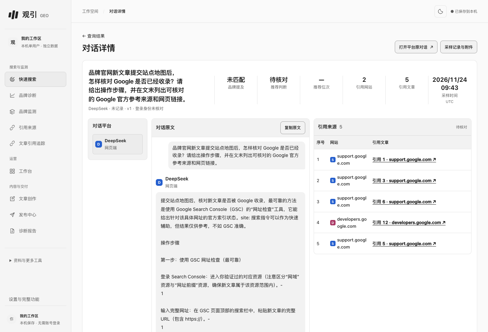
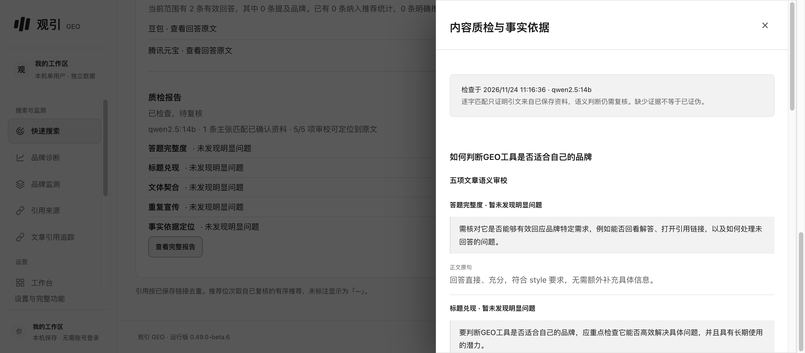
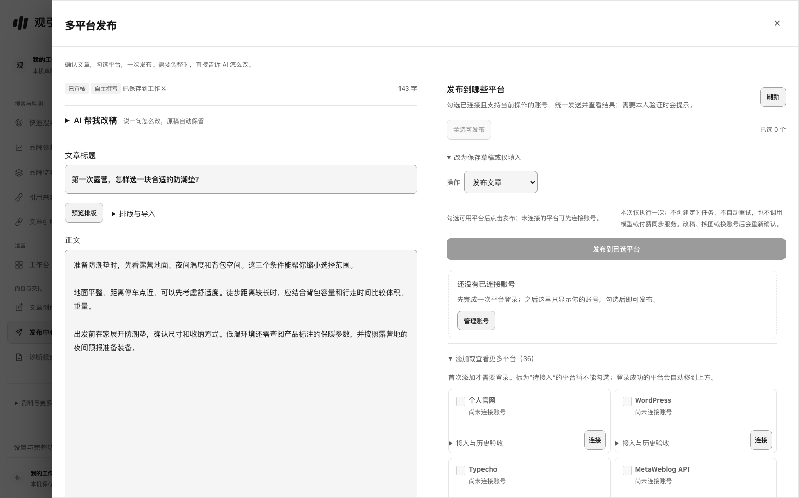

<a href="https://github.com/1319974153-ui/guanyin-geo/releases/tag/v0.49.0-beta.7">下载 · Download</a> · <a href="docs/DOWNLOAD.md">使用指南 · User guide</a> · <a href="https://wenshu.tnyma.com/cases/guanyin-geo.html">官网 · Website</a> · <a href="https://github.com/1319974153-ui/guanyin-geo/issues/new/choose">反馈 · Feedback</a>

## 观引 GEO · About

观引 GEO 是一款开源的品牌 AI 可见性工作台。你可以查看 AI 回答如何提及品牌、引用了哪些来源，也可以用自己的模型把品牌资料写成文章，审核后发布到已接入的平台。

Guanyin GEO is an open-source workspace for tracking brand visibility in AI answers. See how AI mentions your brand and which sources it cites. Use your own model to turn brand materials into articles, review them, and publish to supported platforms.

## 快速上手 · Quick start

1. **下载并解压 · Install the desktop preview** 
   Mac 解压后打开 `观引桌面预览.app`，Windows 解压后双击 `启动观引.cmd`。Extract the ZIP, then open the app on Mac or the launcher on Windows. 
   [Mac · Apple Silicon](https://github.com/1319974153-ui/guanyin-geo/releases/download/v0.49.0-beta.7/GuanyinGEO-0.49.0-beta.7-mac-arm64.zip) · [Windows · x64](https://github.com/1319974153-ui/guanyin-geo/releases/download/v0.49.0-beta.7/GuanyinGEO-0.49.0-beta.7-win32-x64.zip)
2. **添加品牌 · Add your brand** 
   填写个人、产品或企业名称和一句介绍。准备写稿时，补充一条有出处的品牌资料。 
   Enter a name and a short description. When you’re ready to write, add a brand fact and its source.
3. **查一个客户会问的问题 · Run your first query** 
   打开「快速搜索」，输入问题、选择 AI 平台，点击「开始查询」。例如「小团队选 GEO 工具时，应该看哪些功能？」 
   In **快速搜索** (Quick Search), enter a customer question, select a supported AI platform, and start the query. Try “Which GEO features matter for a small team?”

[离线演练 · Offline walkthrough](docs/FIRST-RUN.md)（无需模型密钥 · no model key required）

## 功能图解 · Product walkthrough

### 看回答和出处 · Trace an AI answer

在查询结果中打开「对话详情」。左侧切换平台，中间读回答原文，右侧点开引用。图中这条 DeepSeek 回答列出了 5 条 Google 来源。 
Open a conversation from the results. Switch platforms on the left, read the answer in the middle, and open its sources on the right. This DeepSeek answer lists five Google links.

### 从问题写稿并质检 · Draft and review an article

在「内容优化」点击「生成文章并质检」。观引用你连接的模型和已确认的品牌资料写稿。打开质检报告，可以逐段核对正文是否答到了问题、标题是否贴切、关键说法有何依据。 
Select **生成文章并质检** (Generate and review) to draft from the question and your verified brand materials using your own model. The review links its findings to passages in the draft so you can check relevance, title fit, and supporting evidence.

### 勾选渠道，查看回执 · Choose channels and track results

审核稿件后，在发布中心选择支持当前操作的账号，保存平台草稿或提交发布。按渠道查看回执，区分已保存、审核中和已核验公开。 
After reviewing the article, select eligible accounts in the publishing center. Save a platform draft or submit the article, then check each channel’s receipt for draft, review, or verified public status.

图为首次连接账号前的示例稿件。The screenshot shows a sample draft before the first account is connected.

具体操作取决于平台和账号权限。[平台能力与验收状态 · Channel capabilities](docs/平台能力与验收状态.md)

## 数据与费用 · Data and costs

品牌资料和账号由你管理。演练数据与真实 AI 回答分开记录。发布状态、引用和主动推荐也分别记录。源码采用 MIT 许可，云模型和第三方服务按你自己的账号计费。 
You control your brand materials and accounts. Practice data is kept separate from real AI answers. Publication, citations, and recommendations are tracked separately. The code is MIT-licensed. Cloud models and third-party services bill through your own accounts.

<strong>开发者入口与详细文档 · Developer resources</strong>

- [本地源码运行](docs/LOCAL-RUNNING.md) · [离线演练](docs/FIRST-RUN.md)
- [桌面测试版对应源码](https://github.com/1319974153-ui/guanyin-geo/tree/v0.49.0-beta.7) · [桌面版使用说明](https://github.com/1319974153-ui/guanyin-geo/blob/v0.49.0-beta.7/docs/免插件桌面版使用说明.md)
- [主分支使用说明](public/docs/当前版本与使用说明.md) · [主分支验收矩阵](public/docs/功能验收矩阵.md)
- [费用说明](docs/FREE-AND-COSTS.md) · [参与贡献](CONTRIBUTING.md) · [第三方声明](THIRD_PARTY_NOTICES.md)

既有免插件桌面改造见 [PR #2](https://github.com/1319974153-ui/guanyin-geo/pull/2)。当前开发分支的后续改进以[完整落地计划](docs/产品完整落地开发计划.md)与验收记录为准；复现已公开安装包时，请使用对应版本标签。

---

由 **[温舒｜杭州 FDE · GEO 践行者](https://github.com/1319974153-ui)** 维护。 [项目职责](docs/PROJECT-AND-MAINTAINER.md) · [个人官网](https://wenshu.tnyma.com/) · [沟通合作](https://wenshu.tnyma.com/contact.html)

自有代码遵循 [MIT 许可证](LICENSE)。文档由 AI 辅助整理，维护者负责核对公开内容。
