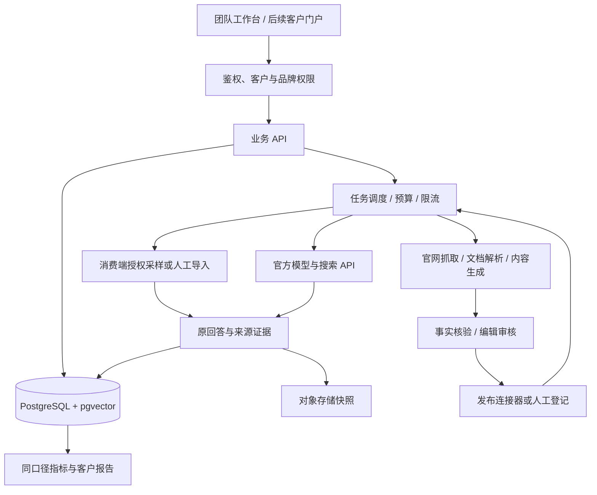

> 此文件保留最初的完整范围规划；其中“预览状态”和开发时间不是当前交付状态。0.3 实際可用能力与未开放项以《当前版本与使用说明》为准。

# 观引 GEO：对标麦豆与 AIDSO 的完整产品实施方案

版本：2026-09-29 / 方案与交互预览 0.1。名称暂定。用户目标：最终做成能用的 GEO 工具平台，由我们决定实现路径。

## 1. 我建议做什么

先做多品牌团队工作台，架构保留客户自助 SaaS。第一阶段让你的团队交付真实客户项目，第二阶段开放客户只读报告与审核，第三阶段再加自助注册、套餐、在线支付。团队代运营和 SaaS 共用品牌、问题、证据、内容与任务系统，不做两套产品。

对标麦豆与 AIDSO 的公开 GEO 功能范围，采用自己的界面、指标与实现，不声称获得其后台代码或专有算法。比单纯复刻更值得投入的是：每个数字能追到原回答；内容到发布到复测可追踪；客户数据与成本严格分开。

**方案说明**：本文件保留最初的产品架构和实施路线。现已具备云端持久化、品牌权限、模型队列、本机执行器及逐步落地的内容、报告与转化功能；准确状态请以同目录“当前版本与使用说明”和“功能验收矩阵”为准。消费端、外部发布与真实账号接入按各自证据独立验收。

## 2. 麦豆的公开能力与我们的模块

麦豆操作指南公开了品牌表现、竞品、提示词、内容检测及 Schema 等工具；其内容助手页面展示的是生成写作提示词后跳转到外部 AI。九步 SOP 明确不提供自动发布。因此，不能把“AI 内容创作发布”栏目名理解成已有全渠道自动发稿。[M1][M2][M3]

| 模块 | 用户具体怎么用 | 我们的实现与交付 | 阶段 |
|---|---|---|---|
| 客户与品牌 | 建客户、品牌、别名、官网、竞品、分配人员 | tenant/client/brand 层级；预算和权限绑定品牌；数据导出与归档 | P1 |
| 问题研究 | 导入客户原话，扩展、聚类、加标签 | 人工问题 + AI 候选；审核后冻结版本；探索集与验收集分开 | P1 |
| 品牌监测 | 配平台、模式、频次，查看回答 | 采样队列、重试、原回答快照、来源和模式；支持人工导入 | P0/P1 |
| 品牌表现 | 看提及、推荐、引用、首段和事实准确度 | 明确分母、日期、有效样本与技术失败；点击数字下钻 | P1 |
| 感知与主题 | 查看好评、误解及关联话题 | 规则 + LLM 结构化标注；展示原句和置信度，可人工改判 | P2 |
| 竞品分析 | 用同一问题集比较竞品 | 对同一批回答提取多个品牌；无序名单不虚构排名；同名排歧 | P1 |
| 引用源 | 查看域名、页面、引用上下文与历史 | URL 规范化、页面去重、引用片段、首次/最近出现；候选与实际引用分开 | P1 |
| 品牌知识库 | 上传资料、确认事实、记录有效期 | 文档解析、事实条目、出处和版本；按品牌检索；冲突与过期提醒 | P1/P2 |
| 内容工作台 | 问题 → 简报 → 草稿 → 审核 | 根据已确认事实检索生成；保留证据关联；风格模板与修订记录 | P2 |
| 发布与追踪 | 审核后建任务，回填或自动取得 URL | 自有 WordPress 优先接 API；其它渠道先导出/人工发布登记；发布、访问、引用分状态 | P2 |
| 网站诊断 | 输入官网，查看可执行整改项 | 公网页抓取、状态/正文/title/heading/canonical/robots/内链/结构化数据检查 | P2 |
| Schema 工具 | 填真实组织/产品/文章信息 | 生成标准 JSON-LD，做语法与字段核验；有效不等于 AI 推荐 | P2 |
| 复盘与报告 | 固定周期比较，关联线索与成本 | 分平台周报、证据附件、客户只读报告、报告版本；有效线索人工/CRM 导入 | P2/P3 |
| 团队与成本 | 分配运营/编辑/审核/客户角色 | 服务端 RBAC、审计、API 配额、任务预算和品牌成本台账 | P1/P3 |

不做无来源的“真实搜索热度”；AI 扩词只标候选优先级。若未来购买问题需求数据，必须记录供应商、覆盖平台、窗口和估算方法。

### 新增参考：AIDSO 与完整覆盖边界

AIDSO 公开页面展示快速问答与来源、行业品牌排行、品牌诊断、知识库和内容生成；诊断入口区分平台、Web/App 与回答模式。其官网还介绍文章引用追踪及非 API 的端侧采样。这些是供应商自述，尚未后台实测或独立验证。[M5][M6][M7]

完整 GEO 范围新增：产品线诊断、单次跨平台查询、Web/App 与模式维度、行业基准、公开搜索词与过程摘要、文章首次/最近引用、告警、客户开放 API、Webhook 与 MCP/Skill。平台未公开的内部推理过程不推测、不复原。行业基准必须建立独立样本库，不能从几个演示品牌生成全行业结论。

AIDSO 官网展示虾搜入口，因此将其列为可采购的采样/诊断连接器候选。正式接口、原始证据完整度、批量权限、价格及商用转供范围尚未核验；不安装第三方镜像 Skill 或直接运行其脚本。获取供应商正式说明后先做小额 PoC，再决定自建还是采购。

AIDSO 的 DSO 搜索词库、直播电商、视频创作是相邻产品能力，不混称 GEO 核心能力。保留扩展模块和预算入口；如要实现全套 DSO，需单独取得关键词数据与渠道权限。麦豆与 AIDSO 登入后可能还有未公开功能，此时以新增验收项补齐，不能声称已经看过全部后台。

## 3. 最重要的技术决策：先解决数据从哪里来

将三种数据面作为不同产品能力，默认不混合计算：

1. **消费端样本**：在豆包、DeepSeek、元宝等实际入口取得的回答。第一版支持人工粘贴/文件导入，记录时间、入口、联网模式、地区语言、问题版本、原回答、来源、截图或分享链接。自动采集只在平台允许或有授权的情况下接入；遇登录、验证码或风控标为受阻，不以代理 API 结果填充。
2. **官方 API 测试**：用于可重复的模型评估、搜索研究和内容生成。API 的模型、系统提示、搜索编排、个人化条件未必与 App 一致，报告明确写 API 测试。品牌私有资料可以用于内容生成，不能注入自然可见度测试的提问上下文。
3. **第三方采样服务**：优先评估 AIDSO 的正式合作接口，采购前要看原始回答、截图、时间、平台入口和地区，并做同题对照。DataForSEO 将 LLM Responses 与 LLM Scraper 分为不同接口；目前其 Scraper 公开页列出 ChatGPT/Gemini，不能借此承诺国内三平台都可自动采。[A5]

**P0 验证优先级**：先检查火山方舟公开的“豆包助手 / doubao_app”能力与账号可用性，它比自行拼接搜索更值得评估；文档称可集成 App 同款 AI 能力，但仍需与当前前台对照，不能直接认定输出等同。国内其它平台先保留真实导入通路与适配接口。[A1]

建议用 20 个固定问题 × 3 个日期 × 3 次重复进行小样本 PoC（每个数据面 180 次，是测试预算示例）。比较：有效返回、来源完整度、提及与引用分布、重复稳定性、单次成本。跨平台表现一致不是必要条件；证明采集的来源与记录真实完整才是首要验收。若自动采集不成立，首版交付“辅助采样运营工具”，不销售“全自动国内平台监测”。

## 4. 需要接哪些 API

| 接入 | 用途 | 接入材料 | 不能据此承诺 |
|---|---|---|---|
| 火山方舟 Responses / 豆包助手 | 豆包能力验证、回答测试、内容生成；评估 doubao_app 和 web_search | 你名下账号、可用模型/应用、后端 API Key、额度；先小额 PoC | 不直接等同当前豆包 App 的自然推荐结果 [A1] |
| 豆包搜索 | 内容研究、找公开事实与候选来源 | 搜索产品开通及专用 Key | 搜索结果不是豆包回答已引用的来源 [A2] |
| 阿里云百炼 / DashScope | 千问联网测试、写作、抽取、可选向量化 | 地域匹配的 Key、模型权限；区分 DashScope 和 Responses 的来源字段 | 不等同千问 App；来源列表和文中引用标记分别解析 [A3] |
| DeepSeek 官方 API | 结构化分析、归类和草稿，作为备选供应商 | API Key、预算、模型能力测试 | 当前 Responses 兼容文档中内置 web_search 等会被忽略，不冒充 DeepSeek 网页搜索 [A4] |
| 腾讯云 Web Search API | 元宝生态相关搜索研究，候选信源发现 | 产品权限与腾讯云鉴权，先确认账号可用范围 | 搜索 API 不等于元宝最终答案 [A6] |
| WordPress REST API | 向客户自有站点创建草稿/审核后发布，回收文章 ID 与 URL | 站点地址、专用低权限用户、Application Password、HTTPS | 不覆盖知乎、B站、头条等第三方账号 [A7] |
| 站点统计 + CRM | AI 引荐、咨询与成交回流 | Umami 站点接入；CRM CSV 或明确 API | 无 referrer 的访问标未知；客户口述标自述，不能全部算 GEO |
| 对象存储 + 邮件/支付 | 快照与附件；邀请/通知；后期 SaaS 订阅 | TOS/OSS、邮件账号；支付商户资质按部署地后续确认 | 当前不自动开通或扣费；账单按供应商实际计量 |

首版不同时购买所有模型：优先火山 + 百炼两条通路，配置统一 provider adapter，遇限流或故障只在同一数据面内按规则切换，不能在客户不知情时把真实前台监测切成模型 API。

所有密钥存在服务端密钥管理中，前端仅看连接状态与用量；客户资料传给哪家模型可配置并留记录。开发技能/MCP 与客户产品运行时 API 是两回事，产品运行不依赖客户安装 Codex。

## 5. 开源选型：小而可控

| 工具 | 用在什么地方 | 选择理由与约束 |
|---|---|---|
| Next.js + TypeScript | 正式版前端、账号入口、工作台 | 统一界面与客户门户；当前交互预览是独立 HTML/JS，不冒充已搭好正式工程 [O1] |
| FastAPI | 品牌/问题/任务/内容/报告服务 | Python 便于连接文档解析和采样任务；业务 API 与后台 worker 分离 [O2] |
| PostgreSQL + pgvector | 业务数据、事实库检索 | 一套主库先满足全文/向量搜索；PostgreSQL RLS 作为租户隔离的第二道防线 [O3][O4] |
| Celery + Valkey | 定时采样、批量生成、重试和预算控制 | 任务状态落主库，队列只负责调度；Celery/Valkey 兼容性锁版本并验证，避免无限重试 [O5][O6] |
| Crawl4AI + Playwright | 客户官网解析、页面渲染和测试 | 前者抽正文，后者渲染及端到端测试；不能当作绕过 AI 平台限制的办法。保留许可与署名 [O7][O8] |
| Docling | PDF、Word 等品牌资料解析 | MIT 代码许可；模型依赖单独核对；保存文档页码和来源定位 [O9] |
| Langfuse | 提示词版本、调用追踪、质量与成本 | 可选，初期先写主库成本日志；核心 MIT，ee 目录另有许可。客户数据脱敏后才进入追踪 [O10] |
| Umami | 自有站点访问与事件分析 | MIT；把识别到的 AI referrer 和表单事件分开，不虚构零点击转化 [O11] |

**不建议把 Dify 直接改皮作为这个多客户平台。**它的公开许可包含多租户服务限制；如果选用须按条款取得相应授权。自研轻量工作流可以减少这项依赖。[O12] n8n 可以后续评估内部通知编排，但暂不作为客户核心运行时；嵌入或托管许可需另核，当前不以“开源即免费商用”决策。

技术版本在 P0 固定 lockfile、容器镜像及许可证清单；不把本方案当成永远有效的版本/商业许可结论。

## 6. 架构与数据设计

核心表：tenants、users、memberships、clients、brands、brand_aliases、brand_memberships、competitors、prompt_sets、prompt_versions、sampling_jobs、runs、answers、citations、source_pages、documents、facts、briefs、content_versions、reviews、publication_jobs、publication_receipts、audits、report_versions、leads、provider_usage、audit_events。

所有业务表带 tenant_id；品牌内容带 brand_id；外键和唯一键包含租户边界。对象文件路径和签名下载也校验相同权限。AI 检索在召回前加权限过滤，不能先跨客户检索再过滤结果。角色：所有者、客户经理、编辑、审核人、客户只读；客户只读无法调用生成、查看密钥或访问别的品牌。

每次样本必须记录：prompt_version、platform、surface（app/web/api/import）、collection_method、model/mode、search_enabled、地区语言、session_policy、captured_at、raw_answer、citations、request_id/证据附件、status、cost。保留拒答和未提及；技术错误单列，不能记成未推荐。

建议接口：POST /brands；POST /prompt-sets/{id}/versions；POST /sampling-jobs；POST /answers/import；GET /answers/{id}/evidence；GET /metrics?surface=...；POST /content/briefs；POST /content/{id}/reviews；POST /publications；POST /audits；POST /reports。变更与任务提交带幂等键，返回 job_id；轮询/SSE 获取真实状态。

## 7. 指标必须可解释

- 提及率 = 包含品牌的有效回答数 / 有效回答数。
- 推荐率 = 将品牌作为适用选项的有效回答数 / 有效回答数；单独输出适用性和否定上下文。
- 官网引用率 = 至少实际引用一次品牌官网的有效回答数 / 有效回答数。
- 来源份额 = 实际引用该来源的回答数 / 带引用的有效回答数；每个回答对同一来源只计一次。多个来源份额之和可能超过 100%。
- 首段提及仅作位置特征；推荐排名只对有明确排序的列表记录，缺失记 null。
- 标注准确度用人工标注集核验；建议首期覆盖至少 100 条含同名、否定、反例、无来源和拒答的样本，标注任务的 Precision/Recall 与错误类型分别报告，目标门槛在 P0 冻结。
- 趋势比较锁定题集版本、平台入口和采样设置；新问题只进入新版本或探索集。
- 商业效果跟踪有效咨询、商机、成交与成本，引用数不等于点击，时间相关不等于因果归因。

## 8. 实施路径与验收门槛

以下是资源规划估算，以 1 名全栈、1 名后端/采集、兼职产品设计与运营验收协作为假设；不是交付日期承诺。关键采集通路未通过时，应暂停扩大功能范围。

| 阶段 | 估算 | 具体交付 | 通过才能进入下一步 |
|---|---|---|---|
| P0 数据与接入验证 | 3–5 个工作日 | 测一个客户品牌；人工样本；方舟/百炼最小 API PoC；采集记录和成本 | 确认哪种数据面可稳定取得；字段完整；错误真实可见；确定首期平台与预算 |
| P1 可交付监测版 | 约 2 周 | 登录、客户/品牌权限、题库版本、任务队列、原回答/引用、竞品、指标和导出 | 两客户隔离；100 条人工标签评估；任务重试不重复计费/写入；暂停和预算上限生效 |
| P2 内容与执行闭环 | 约 2 周 | 文档与事实库、生成/审核、官网诊断、WP 草稿/发布回执、人工渠道台账 | 一条问题 → 一篇审核稿 → 一个上线 URL → 一次复测 → 一份报告完整可追溯 |
| P3 客户门户与商业化 | 约 1–2 周 | 只读客户门户、邀请、报告授权、套餐配额、付费与续费、备份监控 | 客户跨项目访问拒绝；账单对账；备份恢复；故障告警；低权限发布权限验证 |

核心交付版的资源窗口约 5–7 周，不是完整范围的总工期。P4 继续逐项补齐：更多消费端 Web/App 模式、产品线诊断、行业样本库与榜单、公开 API / MCP / Skill、开放 Webhook、通知与高级治理。初步另预留 3–6 周工程窗口；行业数据积累与采集授权另计，不能用固定周数保证完成。完整范围以《功能验收矩阵》逐项关闭，先做核心不代表删减最终范围。

消费端采集、第三方权限、支付审核可能形成外部依赖，不用 API 模拟结果“补齐”进度。正式生产部署前完成客户数据隔离、密钥保护、上传文件限制、抓取 SSRF 防护、访问审计、备份恢复和撤销客户权限测试。

## 9. 成本怎样控制

采样量 = 品牌数 × 固定问题数 × 平台数 × 每月批次 × 每题重复数。例如 10 个品牌 × 30 题 × 3 平台 × 10 批次 × 2 次 = **18,000 次/月**。这只是规模例子，不是推荐套餐。

月成本 = 采样调用费用 + 模型输入/输出 token + 搜索工具费 + 抓取/存储 + 主机数据库 + 人工审核/采样。预览提供可修改的测算器，单次价格是你输入的假设，不能当成供应商报价。

高意向固定题少量高频，探索题低频；每品牌预算与并发上限；无变更文档做内容哈希缓存；重复任务用幂等键；达到软阈值预警、硬阈值暂停。客户套餐按“品牌 + 问题 + 频次 + 重复数 + 数据面”报价，避免无限量监测。第三方充值或购买前再核价和确认实际授权范围。

## 10. 开发会用到的技能

| 技能 | 在本项目中的用途 | 产品运行是否依赖它 |
|---|---|---|
| agent-reach | 核对供应商公开文档和开源项目 | 否；研究工具，不是后台采集接口 |
| impeccable | 产品流程、组件、响应式与可访问性检查 | 否；用于设计开发 |
| arkcli-chat / arkcli-api-explorer / arkcli-usage | 有账号后验证方舟调用、可用能力与用量 | 否；线上走正式 API / SDK，账号由你持有 |
| data-analytics:design-kpis / validate-data | 固定指标口径、基线、分母与异常验收 | 否；成果落为代码、schema 和测试 |
| documents / pdf / spreadsheets | 文档解析方案、客户报告与采样表 | 否；线上使用选定的服务端库 |
| review-security + Playwright | 权限与密钥审查、跨客户隔离和业务流程测试 | 否；保留自动化测试和审计记录 |

当前实际使用了 agent-reach（资料核对）与 impeccable（界面设计）；客户交付技能的隔离和预览真实性原则用作交付参考。表中其它技能是后续阶段计划，不表示本次已经完成对应验证。

## 11. 已决定与后续需要的材料

已决定：团队工作台先行、统一 SaaS 数据模型、国内平台优先、真实前台与 API 测试分开、核心流程自研、两家模型起步、先人工/自有站点发布再拓展渠道。

开发前两项实证输入：一个真实试点品牌的官网/事实资料/客户问题；你名下火山或百炼账号的后端接入权限与预算。现在不需要把密钥粘贴到聊天或预览页面。上线阶段再确定域名、云资源、账号邀请服务和客户合同。我们可以先完成工程与接口适配，真实数据能力以实际接通和验收为准。

## 12. 资料与读取边界

核对日期 2026-09-29。以下为供应商公开说明、官方文档和项目仓库；未登录麦豆后台，也未付费验证第三方采集服务。API 可用型号、账号权限、价格及许可可能改变，P0 以实际开通账号验证。

- [M1 麦豆操作指南](https://www.maidouai.com/guide.html)
- [M2 麦豆内容创作助手](https://maidouai.com/article-create.html)
- [M3 麦豆九步 SOP](https://www.maidouai.com/geonews/14/)
- [M4 麦豆套餐与模块](https://maidouai.com/auth/subscription.html)
- [M5 AIDSO GEO 产品页](https://geo.aidso.com/)
- [M6 AIDSO 品牌诊断入口](https://geo.aidso.com/completeAnalysis)
- [M7 AIDSO 官网功能介绍](https://www.aidso.com/)
- [A1 方舟 Responses 工具与豆包助手](https://docs.volcengine.com/docs/ark/responses-api-tool-calling?lang=zh)
- [A2 豆包搜索能力](https://docs.volcengine.com/docs/ark/agent-plan-enterprise-search?lang=zh)
- [A3 百炼联网搜索与来源字段](https://help.aliyun.com/en/model-studio/web-search)
- [A4 DeepSeek Responses 支持范围](https://api-docs.deepseek.com/guides/responses_api/)
- [A5 DataForSEO LLM Scraper](https://dataforseo.com/pricing/ai-optimization/llm-scraper)
- [A6 腾讯云联网搜索](https://cloud.tencent.com.cn/product/wsa)
- [A7 WordPress 文章 API](https://developer.wordpress.org/rest-api/reference/posts/) / [Application Passwords](https://developer.wordpress.org/advanced-administration/security/application-passwords/)
- [O1 Next.js](https://nextjs.org/docs)
- [O2 FastAPI](https://fastapi.tiangolo.com/)
- [O3 PostgreSQL RLS](https://www.postgresql.org/docs/current/ddl-rowsecurity.html)
- [O4 pgvector](https://github.com/pgvector/pgvector)
- [O5 Celery 许可](https://github.com/celery/celery/blob/main/LICENSE)
- [O6 Valkey](https://valkey.io/topics/introduction/)
- [O7 Crawl4AI](https://github.com/unclecode/crawl4ai)
- [O8 Playwright](https://github.com/microsoft/playwright)
- [O9 Docling](https://github.com/docling-project/docling)
- [O10 Langfuse](https://github.com/langfuse/langfuse)
- [O11 Umami 许可](https://github.com/umami-software/umami/blob/master/LICENSE)
- [O12 Dify 许可](https://github.com/langgenius/dify/blob/main/LICENSE)
